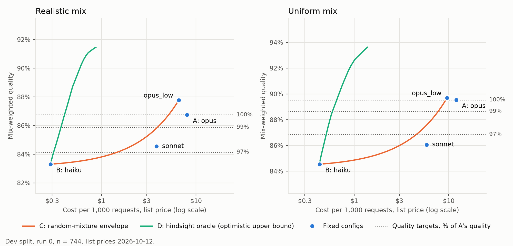

# API Cost Optimizer

How much can you cut LLM inference cost without materially reducing answer quality, and which
decision strategy gets closest to the best possible tradeoff?

This project measures that on Anthropic's Claude 5.5 models. It compares routers (which pick a
model per request) and cascades (which try a cheap model first and escalate when a quality gate
fails) against two references: a hindsight oracle that shows the most any strategy could save,
and random mixtures that show what you get with no routing intelligence at all.

**Status:** Stages 0–4 are done. The pilot chose four tasks ([Amendment A3](PLAN_v4.md)), the
benchmark of 2,478 items is split and frozen ([Amendment A5](PLAN_v4.md)), and the collection run
has answered every item through every config for $29.37: train and dev are scored, and test is
sealed until Stage 8 ([Amendment A6](PLAN_v4.md)). Stage 3 built the offline simulator, the four
references and a paired bootstrap, and drew Pareto chart v0 on dev ([Amendment A8](PLAN_v4.md),
whose item 12 records its headline numbers). Stage 4 built the routers' shared parts (the request a
router sees, router-score tables, the walk that picks thresholds, McNemar's test) and the first
router, E, a set of hand-written rules whose router scores are train success rates. E was frozen
before any dev number was computed, then walked on dev: chart and table v1 show its steps and its
six operating points, and [Amendment A9](PLAN_v4.md) item 18 records them with the hash of E's
section of the operating-points file. Amendment A10, from the branch review, adds the decision rule
to the freeze and records how E's frozen cues read A9. Stage 5, the embedding router, is next. Every
result so far is on dev, with the test split still sealed.



## Approach

- **One results matrix, then offline evaluation.** Every benchmark item runs once through every
  model config. Routers and cascades are then scored by lookup, with no new API calls, so every
  strategy is compared on exactly the same answers.
- **References, not just baselines.** Besides always-frontier and always-cheapest, the matrix
  gives a hindsight oracle (a multiple-choice knapsack relaxed to a linear program) and the
  envelope of random mixtures. Systems report the fraction of the oracle's savings they capture
  at the same quality target.
- **Routers, simplest first:** a rules baseline, then a classifier trained on prompt embeddings,
  then Jev (TypeSafe's decision model). Routers are compared at matched cost or matched quality,
  not as single points.
- **Gates and cascades:** schema and code-execution checks, Jev as a gate, and a Sonnet verifier.
- **A sealed test split.** Items are split 40 / 30 / 30 into train / dev / test. Test answers are
  collected in the same run as dev but aren't scored until the final stage. Every operating
  threshold is chosen on dev and must clear its quality target by a stated margin (by default,
  one standard error).

The full design, including every decision and its reason, is in [PLAN_v4.md](PLAN_v4.md).

## Model configs

A config is a (model, effort) pair, pinned in [configs/models.yaml](configs/models.yaml) with one
shared price snapshot (2026-10-12, USD per 1M input / output tokens).

| Config | Model | Effort | Price |
|---|---|---|---|
| `haiku` | `claude-haiku-5-5` | high | $0.10 / $0.50 |
| `sonnet` | `claude-sonnet-5-5` | high | $2 / $10 |
| `opus_low` | `claude-opus-5-5` | low | $4 / $20 |
| `opus` | `claude-opus-5-5` | medium (frontier) | $4 / $20 |

Bulk runs use the Message Batches API at half price. The working budget is $150.

## Pilot candidate datasets

The pilot ran 20 items from each candidate through every config, plus 20 MATH Level 5 items,
and kept four task types. MATH and CRUXEval were dropped because every config answered every
item correctly, which leaves no routing decision to study. IFBench and LiveCodeBench were then
tested as ways to add items to the two smallest tasks and left out ([Amendment A4](PLAN_v4.md)):
LiveCodeBench was saturated too, and IFBench scored every config about the same while drawing
refusals.

| Dataset | Task type | Scoring | License | Pilot outcome |
|---|---|---|---|---|
| [IFEval](https://huggingface.co/datasets/google/IFEval) | instruction following | strict instruction checks | Apache 2.0 | **kept** |
| [Banking77](https://huggingface.co/datasets/PolyAI/banking77) ([copy used](https://huggingface.co/datasets/mteb/banking77)) | classification | exact label | CC BY 4.0 | **kept**, JSON answer |
| [MMLU-Pro](https://huggingface.co/datasets/TIGER-Lab/MMLU-Pro) | multiple choice | answer letter | MIT | **kept**, JSON answer |
| [MBPP+](https://huggingface.co/datasets/evalplus/mbppplus) | coding | run the tests | Apache 2.0 | **kept** |
| [MATH](https://huggingface.co/datasets/EleutherAI/hendrycks_math) | math | answer equivalence | MIT | dropped: saturated, Level 5 too |
| [CRUXEval](https://huggingface.co/datasets/cruxeval-org/cruxeval) | code reasoning (output prediction) | Python literal | MIT | dropped: saturated |
| [IFBench](https://huggingface.co/datasets/allenai/IFBench_test) | instruction following | strict instruction checks | ODC-BY | not added: no separation, refusals |
| [LiveCodeBench](https://huggingface.co/datasets/livecodebench/code_generation_lite) v5–v6 | coding | run the tests | see card | not added: saturated |

Dataset revisions are pinned in [harness/loaders.py](harness/loaders.py), so an item ID always
means the same item.

## Running it

Requires [uv](https://docs.astral.sh/uv/), Docker (for the code sandbox), and an Anthropic API
key in a `.env` file at the project root (`ANTHROPIC_API_KEY=...`; it's gitignored).

```bash
uv sync
git config core.hooksPath .githooks        # once per clone: run the fast checks before every commit
.githooks/pre-commit                       # the fast checks: ruff, mypy, check_sealed and the analysis checks below
uv run python -m harness.check_sealed      # no code but harness/collect.py names the sealed test store, and only allowlisted files name the benchmark
uv run python -m harness.smoke_test        # one Haiku call: checks the key and the response store
uv run python -m harness.sandbox --build   # build the pinned sandbox image
uv run python -m harness.check_sandbox     # escape checks + every MBPP+ reference solution
uv run python -m harness.build_pilot       # regenerate the pilot files (same seed, same items)
uv run python -m harness.check_evaluators  # every evaluator against the reference answers (needs the sandbox)
uv run python -m harness.run_pilot --configs haiku --per-source 3   # 18-item trial
uv run python -m harness.run_pilot         # full pilot: 120 items x 4 configs, then the Stage 0 summary
uv run python -m harness.run_pilot --pilot-file data/pilot_math_level5.jsonl --formats structured
uv run python -m harness.run_pilot --pilot-file data/pilot_added_sources.jsonl --formats free
uv run python -m harness.build_benchmark   # rebuild the frozen benchmark (seeded; byte-identical)
uv run python -m harness.check_benchmark   # verify it against its manifest hashes
uv run python -m harness.check_collect     # the collection runner end to end against a fake Batches API (no calls)
uv run python -m harness.collect plan      # Stage 2 request counts and projected cost; then submit, wait, score, seal
uv run python -m analysis.fit_rules_router # fit E on train and write routers/rules_rates.json (then frozen, A9 item 17)
uv run python -m analysis.rules_table      # E's dev router-score table: score(request) on every dev request
uv run python -m analysis.dev_diagnostic   # the dev task-inference diagnostic, on this benchmark's templates
uv run python -m analysis.rules_walk       # the walk on dev: writes E's section of routers/operating_points.json
uv run python -m analysis.pareto           # chart v1 on dev: prints tables v0 and v1, writes the figures and their JSONs
uv run python -m analysis.check_simulator  # the analysis package on hand-worked cases, then on dev against the figures and A8's record
uv run python -m analysis.check_routers    # the router foundation, the benchmark reader and the router-score table
uv run python -m analysis.check_comparisons  # McNemar's test and the matched-cost difference
uv run python -m analysis.check_walk       # breakpoints, steps, the walk and the operating-points file, on synthetic tables
uv run python -m analysis.check_metrics    # within-task concordance, log loss, the same-target comparison and the operating-points allowlist
uv run python -m analysis.check_rules_router  # E's cues, fit and freeze hashes (A9 item 17), and A10's record against the frozen code
uv run python -m analysis.check_chart_routers  # the chart script's router list: E's entry and style, F's reserved, two routers drawn
uv run python -m analysis.fetch_model      # once: the five embedding-model files at A11's pinned commit, into .cache/ (the router never fetches)
uv run python -m analysis.check_trained_router  # the trained router's foundation, on a fake backend; with the snapshot, also the real tokenizer's window
uv run python -m analysis.fit_trained_router caches    # F's embedding caches of train and dev requests, into results/trained_embeddings/ (no outcome read)
uv run python -m analysis.fit_trained_router settings  # F's settings and F-train's weights, from train alone (A11 items 5, 7, 12)
uv run python -m analysis.measure_trained_router drift | latency | environment | tokens | record [--write]  # the drift limit, latency and item 19 (run latency alone)
uv run python -m analysis.fit_trained_router folds     # the fit commit only: the five fold models (reads dev outcomes, prints nothing about them)
uv run python -m analysis.check_trained_freeze  # F's train-side fit on synthetic data, and A11 item 19 against its sources; the hook adds the snapshot and train matrix
uv run python -m analysis.check_trained_fit  # A11 item 20 against the fold weights; the hook adds the history and the refit to 1e-9
uv run python -m analysis.trained_table   # F's and F-train's dev router-score tables, and each fold model's quantiles (no outcome read)
uv run python -m analysis.trained_walk    # F's walks on dev, and F's section of routers/operating_points.json (E's untouched)
uv run python -m analysis.check_trained_dev  # F and F-train on dev, against score_with; the hook only, it needs the dev cache and matrix
uv run python -m analysis.check_stage4     # E on dev, tables v0 and v1, A9's record (item 18) and the Stage 3 numbers A9 quotes, against the JSONs
```

The matrix-reading commands need the dev results matrix in `results/`, so they need the collection
run's stores; so do `check_simulator` and `check_stage4`, which the hook runs where the matrix is
present, and the refit half of `check_rules_router`. Chart v1 takes a few seconds: the paired
bootstrap re-solves the hindsight oracle on every resample. Run the three E steps in the order
`rules_table`, `dev_diagnostic`, `rules_walk` (A9 item 13), which is also the order of their commits.

The first LiveCodeBench load downloads about 690 MB and writes its decoded tests (about 500 MB)
to `.cache/`.

Every answer is scored right or wrong (`quality` 1 or 0), and IFEval counts as right only when
every instruction is followed. An answer missing the format its prompt asks for (`Answer: X`,
`\boxed{}`, a code block) scores as a format failure, which is counted separately from a wrong
answer.

The pilot ran Banking77, MMLU-Pro, MATH and CRUXEval twice on the same items: once in free text,
and once with the answer requested as JSON through the API's structured outputs. JSON removed
every format failure without costing accuracy, so Banking77 and MMLU-Pro answer as JSON from
here on. IFEval and MBPP+ stay free text, since IFEval's instructions are about the text's shape
and code belongs in a code block.

Every API response is cached on disk under `results/` (not committed), keyed by a hash of the
full request, so re-running analysis never pays for the same call twice.

Model-written code runs in a fresh Docker container per execution: no network, a read-only file
system, none of your files, an unprivileged user, and caps on memory, processes, time and output.

## Layout

```text
PLAN_v4.md           study design (frozen before Stage 0, with amendments A1–A10)
GLOSSARY.md          the study's vocabulary from Stage 3 on: policy, trace, config ladder, reference, request,
                     router score, threshold, walk, operating point, ...
WRITEUP.md           the final write-up (to come) and running notes for it
CODING_STANDARDS.md  the judgement calls code review applies; ruff and mypy (pyproject.toml) cover the rest
.githooks/pre-commit the fast checks, run before every commit; CI runs them too (.github/workflows/)
configs/models.yaml  pinned model configs, output caps and price snapshot
configs/task_mix.yaml  the uniform and realistic task mixes
harness/             API client, response store, dataset loaders, evaluators, code sandbox, pilot
                     builder and runner, benchmark builder and checker, collection runner, check
                     and review scripts, LiveCodeBench test runner (unused; Amendment A4)
harness/ifeval/      Google's IFEval instruction checkers, vendored at a pinned commit
harness/ifbench/     AI2's IFBench instruction checkers, vendored at a pinned commit
analysis/            the offline simulator (traces to outcomes and totals), the results-matrix loader,
                     references C and D, the paired bootstrap, the benchmark reader, the router-score table,
                     the walk and operating points, McNemar's test, E's fit on train and its freeze hashes,
                     E's table, diagnostic and walk on dev, chart v1 and the check scripts
routers/             the deployable routers (imports nothing from analysis or harness): the config ladder,
                     the request, the decision rule (frozen, A10 item 1), the rules router E (frozen, A9
                     item 17) and its rates file rules_rates.json, and operating_points.json, every
                     router's thresholds from the walk
figures/             chart v1 on dev: the headline and per-task figures, each a PNG with a JSON of every
                     number it plots, tables v0 and v1 included
sandbox/             Dockerfile for the code sandbox image
data/benchmark.jsonl the frozen benchmark: 2,478 items split 40/30/30, plus its hash manifest
data/pilot*.jsonl    Stage 0 pilot items: 20 per candidate dataset, 20 MATH Level 5 items, and
                     20 each from IFBench and LiveCodeBench
data/collection_manifest.json  batch IDs, counts and the sealed test store's hash (Amendment A6)
results/             response store, dev matrix and sealed test store (not committed)
.cache/              downloaded tool data and LiveCodeBench's decoded tests (not committed)
docs/history/        earlier versions of the plan
```

## Progress

- [x] Study plan frozen (v4, amendments A1–A10)
- [x] Harness: API client, on-disk response store, pinned model configs
- [x] Dataset loaders at pinned revisions, and 120 pilot items
- [x] Docker code sandbox (18/18 escape checks; 377/377 MBPP+ reference solutions pass under the
      grader's limits, with 1 excluded)
- [x] Evaluators for the six candidate datasets, checked against every reference answer in the
      candidate pools
- [x] Pilot runner, tested on an 18-item Haiku trial
- [x] Pilot run ($4.72): four tasks chosen, JSON answers for Banking77 and MMLU-Pro, output caps
      set, collection run projected at about $26–30 against the $150 ceiling
- [x] IFBench and LiveCodeBench tested as extra items for the two smallest tasks ($3.89); not added
- [x] Stage 1: benchmark frozen. IFEval 521, Banking77 800, MMLU-Pro 800 and MBPP+ 357 items, split
      40/30/30 and stratified, with a noise subset, the two task mixes and hashes
- [x] Stage 2: collection run ($29.37); train and dev scored, test sealed
- [x] Stage 3: offline simulator, references A–D (the random-mixture envelope and the hindsight
      oracle as an LP), the paired bootstrap and safety margin, and Pareto chart v0 on dev with the
      per-task figure and table v0
- [x] Stage 4: the shared router parts, the rules router E fitted on train and frozen, then on dev
      its router-score table, task-inference diagnostic and walk; chart and table v1 with E's six
      operating points, and A9's record of them (item 18); A10 adds the decision rule to the freeze
- [ ] Stages 5–8: the embedding router, Jev's router, gates and cascades, final evaluation on the
      sealed test split

## License

The code and documentation are released under the [MIT License](LICENSE), except
`harness/ifeval/` (Google's code) and `harness/ifbench/` (AI2's code), which stay under the Apache
License 2.0 (a copy is in each folder). Dataset items in
`data/`, and anything the loaders download, remain under their original licenses, listed in the
[pilot datasets table](#pilot-candidate-datasets) above.
